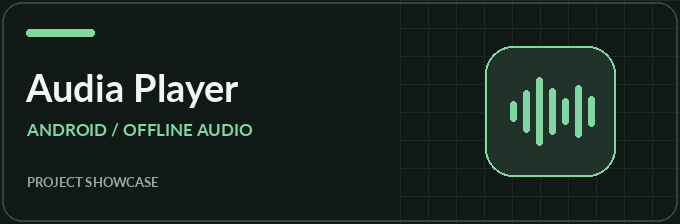
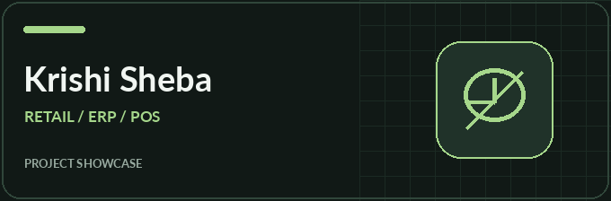
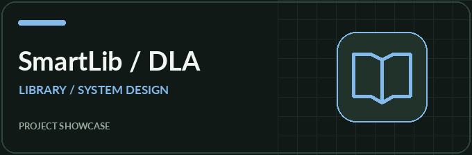
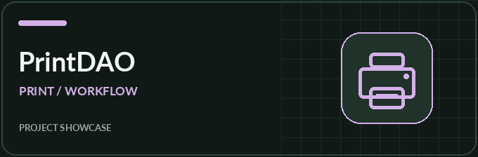
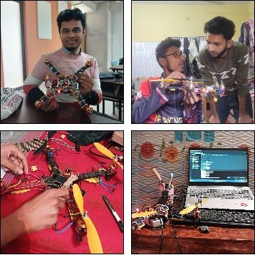
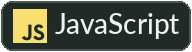
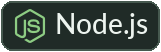
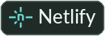
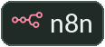

  
  
    

## About me

I am a Computer Science & Engineering student at Varendra University, Bangladesh. I build web and mobile applications, connect services and explore how software can improve business operations. My background in radio broadcasting also shapes how I communicate and tell stories.

**Open to:** Entry-level roles, internships, paid freelance projects and remote collaboration.

## Selected work

Applications, prototypes and academic projects — what they do, how they are built and where to explore them.

<table>
  <tr>
    <td width="50%" valign="top">
      
      
Android app · Public release

      
Offline music player with adaptive layouts, media controls and scheduled playback.

      
   

      
Kotlin and Compose for the interface, Media3 for playback, Room for storage.

      
<b><a href="https://tanjilhasanhimel.me/audia/">App website</a> &nbsp;·&nbsp; <a href="https://github.com/TanjilHasan-Himel/app">Source code</a> &nbsp;·&nbsp; <a href="https://github.com/TanjilHasan-Himel/app/releases/latest/download/Audia-latest.apk">Download APK</a></b>

    </td>
    <td width="50%" valign="top">
      
      
Retail SaaS · Prototype

      
Agricultural retail operations: inventory, sales, credit and accounting.

      
 

      
Next.js for the web interface and PostgreSQL for operational data.

      
<b><a href="https://khrisisheba-saas-pos.vercel.app/">Live demo</a> &nbsp;·&nbsp; <a href="https://tanjilhasanhimel.me/krishisheba/">Case study</a></b>

    </td>
  </tr>
  <tr>
    <td width="50%" valign="top">
      
      
Academic team project

      
Library workflows for student verification, borrowing, returns and librarian operations.

      
  

      
Flutter for mobile, Django REST for APIs and MongoDB Atlas for records.

      
<b><a href="https://tanjilhasanhimel.me/smartlib/">Case study</a> &nbsp;·&nbsp; <a href="https://www.youtube.com/watch?v=SxjPciMqh5Y&amp;t=816s">Project video</a></b>

    </td>
    <td width="50%" valign="top">
      
      
Workflow automation · Prototype

      
Document upload, payment approval, print queues and desktop printer integration.

      
  

      
Next.js portal, Supabase queue updates and Python desktop bridge.

      
<b><a href="https://tanjilhasanhimel.me/printdao/">Case study</a></b>

    </td>
  </tr>
</table>

### Additional projects

| Project | What I built / explored | Explore |
| :--- | :--- | :--- |
| **Quark Ledger** | News collection and routing with n8n and webhooks | [Website](https://quarkledger.vercel.app/) |
| **T Double H FM** | Internet radio and digital audio delivery | [Website](https://tdoublehfm.vercel.app/) |
| **AI Writing Assistant** | Academic prototype: PHP, MySQL and local Ollama integration | — |
| **Nirbhor** | Domestic helper platform: React, Express.js, MySQL2 and JWT | — |

### Embedded systems

<table>
<tr><td width="42%" valign="top"></td><td width="58%" valign="top">
<h3>ESP32 Custom Flight Controller</h3>

Academic team project exploring custom flight control rather than a ready-made controller.

  

<b>Sensor fusion:</b> MPU6050 · Madgwick filter <b>Control:</b> PID · motor mixing · PWM · ESC calibration <b>Communication:</b> UDP / Wi-Fi

</td></tr></table>

## Technology toolkit

Organized by purpose rather than proficiency. These include project experience, coursework and tools I have explored.

<table>
  <tr>
    <td width="50%" valign="top"><b>Web applications</b>
Interfaces, dashboards and business workflows.

    
HTML · CSS · shadcn/ui · Vite</td>
    <td width="50%" valign="top"><b>Websites &amp; CMS</b>
Content-managed websites and local development.

  
Local WP · XAMPP</td>
  </tr>
  <tr>
    <td width="50%" valign="top"><b>Mobile applications</b>
Native Android and cross-platform interfaces.

   
Compose · Media3 · ExoPlayer · Room</td>
    <td width="50%" valign="top"><b>Backend &amp; APIs</b>
Application logic, authentication and integrations.

   
Django REST Framework · REST APIs · Fastify (architecture)</td>
  </tr>
  <tr>
    <td width="50%" valign="top"><b>Databases</b>
Application data, storage and realtime updates.

   
SQLite · Firebase · Prisma · MySQL</td>
    <td width="50%" valign="top"><b>Deployment &amp; hosting</b>
Deploying websites and backend services.

   
Docker · Linux · cPanel · Namecheap</td>
  </tr>
  <tr>
    <td width="50%" valign="top"><b>Development workflow</b>
Version control, builds and dependency management.

   
Gradle · npm · pnpm</td>
    <td width="50%" valign="top"><b>Testing &amp; design</b>
Testing endpoints and documenting systems.

  
REST Client · Mermaid · draw.io</td>
  </tr>
  <tr>
    <td width="50%" valign="top"><b>Programming fundamentals</b>
Coursework, embedded systems and queries.

  
SQL · Python</td>
    <td width="50%" valign="top"><b>Integration &amp; desktop</b>
Desktop utilities, security and payment workflows.

  
Tkinter · CustomTkinter · JWT · bcrypt · CORS · cURL · RLS · SSLCOMMERZ (sandbox)</td>
  </tr>
</table>

## Data, analytics & automation

<table>
  <tr>
    <td width="50%" valign="top"><b>Data analysis</b>
Cleaning, exploring and visualizing datasets.

   
SQL · Microsoft Excel</td>
    <td width="50%" valign="top"><b>Machine learning</b>
Coursework and model experimentation.

  
Jupyter Notebook · Google Colab</td>
  </tr>
  <tr>
    <td width="50%" valign="top"><b>Workflow automation</b>
Connecting services and reducing repetitive work.

  
MCP · API integration</td>
    <td width="50%" valign="top"><b>Model integration</b>
Working with hosted and local models.

   
Google AI Studio</td>
  </tr>
</table>

<b>Development assistants</b> — optional tools in my workflow

OpenAI Codex · Claude Code · Cursor · GitHub Copilot · Google Antigravity · Bolt.new

## Product & business perspective

I am interested in the requirements, user needs and operational decisions behind digital products. The following are examples of product thinking in my projects, not claims of formal analyst or product manager experience.

| Focus | Example |
| :--- | :--- |
| Requirements & business workflows | **Krishi Sheba:** retail operations and inventory; **PrintDAO:** approval and queue flow |
| User roles & system design | **SmartLib:** student verification and library operations |
| Product experience | **Audia Player:** offline playback and adaptive interfaces |

**Planning & documentation:**    

Microsoft Excel · Mermaid · draw.io

## Beyond engineering

<table>
<tr>
<td width="50%" valign="top">
<h3>On the air</h3>
<b>Radio Padma 99.2 FM · Presenter / RJ</b>

Live presenting, audience engagement, storytelling and collaboration.

<b>Selected shows</b> Hello Rajshahi · Ferari Bikel · Duronto Rajshahi · World Music · Your Request Your Playlist · Bioscope

</td>
<td width="50%" valign="top">
<h3>Creative production</h3>

Audio editing, restoration, video editing and visual storytelling.

   

Studio One 6 · iZotope RX · CapCut · Blackmagic Camera

</td>
</tr>
</table>

Additional implementation details

- SmartLib: MongoDB Atlas, Stripe and SSLCOMMERZ sandbox integrations.
- PrintDAO: Supabase Realtime, Row-Level Security (RLS), Python and CustomTkinter.
- Nirbhor: MySQL2, JWT, bcrypt and CORS.
- AI Writing Assistant: PHP, Ollama and cURL.
- Audia: Android Studio, Gradle, Jetpack Compose, Media3 / ExoPlayer and Room Database.

---

<a href="https://tanjilhasanhimel.me/">Portfolio and full case studies →</a>

