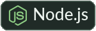
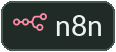

  
  
    

About me
I am a Computer Science & Engineering student at Varendra University, Bangladesh. I build web and mobile applications, connect services and explore how software can improve business operations. My background in radio broadcasting also shapes how I communicate and tell stories.

Open to: Entry-level roles, internships, paid freelance projects and remote collaboration.
Featured capstone — SmartLib / Digital Library Assistant
<table>
<tr><td width="38%" valign="top">
<b>B.Sc. CSE Final Year Project · July 2026</b>

Varendra University, Department of CSE

<b>Supervisor:</b> Md. Arshad Wasif, Lecturer, Dept. of CSE
</td><td width="62%" valign="top"><h3>One platform for students, librarians and institutions</h3>
Multi-tenant library management with a student mobile app, librarian dashboard, super-admin dashboard and centralized REST backend.

<b>My role:</b> Team lead and core developer — system architecture, mobile development, core implementation, testing and documentation.

   

<b><a href="https://tanjilhasanhimel.me/smartlib/">Read project case study</a> &nbsp;·&nbsp; <a href="https://www.youtube.com/watch?v=SxjPciMqh5Y&amp;t=816s">Watch project demonstration</a></b>
</td></tr>
</table>

<b>Explore architecture &amp; implementation</b>
System area	Implementation
Multi-tenant architecture	Separate institutional data and administration; configurable borrowing limits, renewal periods, grace periods and fines; audit logging.
Institutional onboarding	CSV import and university-specific API integration (including a separate integration server); Django database routing to legacy SQL student records.
Identity & access	JWT access/refresh tokens, configurable login validity, role-based access control (Student, Librarian, Super Admin), email OTP and 30-second rotating HMAC-SHA256 QR IDs.
Library operations	Catalog and stock management, checkout and return, expected return-date estimation, digital receipts and PDF reporting.
AI assistant	Gemini API with dynamic database context and per-student usage quotas.
Notifications	Custom SMTP-based email templates, OTP, in-app alerts and book availability subscriptions.
Payments	Tenant-specific fine calculation, Stripe and SSLCOMMERZ sandbox checkout and webhook updates.
Infrastructure	Flutter/Dart mobile client; HTML, CSS and JavaScript dashboards; Python/Django REST Framework; MongoDB Atlas free tier (via Djongo); Render deployment and temporary DigitalOcean use.

Project team: Tanjil Hasan, Md. Rashidul Islam, Khadiza-tul Kubra Orin. The project was a collaborative final-year submission; my focus was architecture, mobile and core system development.

Prototype scope: Primarily tested on Android; physical iOS testing and production-scale deployment remain outside the demonstrated scope.

Selected work
<table>
<tr>
<td width="50%" valign="top">
      
      <h3>Audia Player</h3>
      
Android app · Public release

      
Offline music player with adaptive layouts, media controls and scheduled playback.

      
   

      
Kotlin and Compose for the interface, Media3 / ExoPlayer for playback, Room for storage; Android Studio and Gradle for builds.

      
<b><a href="https://tanjilhasanhimel.me/audia/">View app website</a> &nbsp;·&nbsp; <a href="https://github.com/TanjilHasan-Himel/app">View source code</a> &nbsp;·&nbsp; <a href="https://github.com/TanjilHasan-Himel/app/releases/latest/download/Audia-latest.apk">Download Android APK</a></b>

    </td><td width="50%" valign="top">
      
      <h3>Krishi Sheba</h3>
      
Retail SaaS · Prototype

      
Agricultural retail operations: inventory, sales, credit and accounting.

      
 

      
Next.js for the web interface and PostgreSQL for operational data.

      
<b><a href="https://khrisisheba-saas-pos.vercel.app/">Live demo</a> &nbsp;·&nbsp; <a href="https://tanjilhasanhimel.me/krishisheba/">Case study</a></b>

    </td>
</tr>
<tr>
<td width="50%" valign="top">
      
      <h3>PrintDAO</h3>
      
Workflow automation · Prototype

      
Document upload, payment approval, print queues and desktop printer integration.

      
  

      
Next.js portal, Supabase Realtime and row-level security (RLS), Python / CustomTkinter desktop bridge.

      
<b><a href="https://printdao.vercel.app/">Open live demo</a> &nbsp;·&nbsp; <a href="https://tanjilhasanhimel.me/printdao/">Read case study</a></b>

    </td><td width="50%" valign="top"><h3>Other applications</h3>
<b><a href="https://quarkledger.vercel.app/">Quark Ledger</a></b> — news collection and routing with n8n and webhooks.

<b><a href="https://tdoublehfm.vercel.app/">T Double H FM</a></b> — internet radio and audio delivery.

<b>AI Writing Assistant</b> — PHP, MySQL, cURL and local Ollama integration.

<b>Nirbhor</b> — React, Express.js, MySQL2 and JWT, bcrypt and CORS.
</td>
</tr>
</table>Embedded systems
<table>
<tr><td width="42%" valign="top"></td><td width="58%" valign="top">
<h3>ESP32 Custom Flight Controller</h3>

Academic team project exploring custom flight control rather than a ready-made controller.

  

<b>Sensor fusion:</b> MPU6050 · Madgwick filter <b>Control:</b> PID · motor mixing · PWM · ESC calibration <b>Communication:</b> UDP / Wi-Fi

</td></tr></table>Product & business perspective
I approach software as a way to improve real workflows: identify the problem, understand users, design the process and translate requirements into a practical solution.

<b>Requirements, product decisions &amp; business workflows</b>
Project	Product / business contribution
SmartLib	Student and library staff requirements, role separation, configurable institutional policies and legacy-system onboarding.
Krishi Sheba	Retail sales, inventory, credit and accounting workflows.
PrintDAO	Upload-to-print journey, payment verification, queue and operator workflows.
Audia Player	Offline listening experience, adaptive layouts and playback convenience.

These are examples of product thinking from my projects, rather than claims of formal analyst or product manager employment.

<b>Planning, documentation &amp; collaboration</b>
<table>
<tr>
<td width="50%" valign="top"><b>Product planning</b>
Organizing requirements, tasks and documentation.

  
</td><td width="50%" valign="top"><b>Visual &amp; workflow design</b>
UI design, diagrams and process communication.

  
</td>
</tr>
</table>
Technology toolkit
Tools I have used or explored across projects and coursework. Each item has one primary home in the toolkit; project-specific stacks above intentionally repeat only where they explain the implementation.

<b>01 · Programming languages &amp; queries</b>
<table>
<tr>
<td width="50%" valign="top"><b>Application development</b>
Web, mobile, backend and academic programming.

     
</td><td width="50%" valign="top"><b>Systems &amp; database queries</b>
Embedded programming, server-side scripting and relational queries.

   
</td>
</tr>
</table>

<b>02 · Web, CMS &amp; mobile development</b>
<table>
<tr>
<td width="50%" valign="top"><b>Web applications</b>
Interfaces, dashboards and business systems.

      
</td><td width="50%" valign="top"><b>CMS &amp; websites</b>
Content-managed websites and local development.

  
</td>
</tr>
<tr>
<td width="50%" valign="top"><b>Mobile applications</b>
Native Android and cross-platform UI.

  
</td><td width="50%" valign="top"><b>Media &amp; local data</b>
Playback and local application storage.

  
</td>
</tr>
</table>

<b>03 · Backend, databases &amp; integrations</b>
<table>
<tr>
<td width="50%" valign="top"><b>Backend &amp; desktop</b>
REST service logic and desktop utilities.

      
</td><td width="50%" valign="top"><b>Relational data &amp; ORM</b>
Structured records, local data and database access.

     
</td>
</tr>
<tr>
<td width="50%" valign="top"><b>Document &amp; realtime data</b>
Flexible documents, caching and backend services.

     
</td><td width="50%" valign="top"><b>Identity &amp; service integration</b>
Authentication, access policy, communication and payment flows.

           
</td>
</tr>
</table>

<b>04 · Hosting, deployment &amp; engineering workflow</b>
<table>
<tr>
<td width="50%" valign="top"><b>Hosting &amp; cloud</b>
Deploying websites and backend services.

    
</td><td width="50%" valign="top"><b>Infrastructure &amp; delivery</b>
Deployment environments and domain management.

    
</td>
</tr>
<tr>
<td width="50%" valign="top"><b>Development workflow</b>
Version control, editor and build tools.

     
</td><td width="50%" valign="top"><b>Testing &amp; API inspection</b>
Endpoint inspection and software testing.

  
</td>
</tr>
</table>

<b>05 · Embedded systems</b>
<table>
<tr>
<td width="50%" valign="top"><b>Hardware &amp; communication</b>
Microcontroller programming and connectivity.

    
</td><td width="50%" valign="top"><b>Control &amp; signal processing</b>
Drone sensor fusion and motor control.

   
</td>
</tr>
</table>
Data, analytics & automation
Data exploration, model experimentation and service integration across projects and coursework.

<b>Data analytics &amp; machine learning</b>
<table>
<tr>
<td width="50%" valign="top"><b>Data analysis</b>
Cleaning, exploring and visualizing data.

   
</td><td width="50%" valign="top"><b>Machine learning</b>
Coursework and model experimentation.

    
</td>
</tr>
</table>

<b>Workflow automation &amp; model integration</b>
<table>
<tr>
<td width="50%" valign="top"><b>Workflow automation</b>
Connecting services and automating processes.

  
</td><td width="50%" valign="top"><b>Model integration</b>
Hosted and local model APIs.

    
</td>
</tr>
</table>
Development assistants
I use development assistants as supporting tools for prototyping, implementation and reviewing code.

<b>AI-assisted development tools</b>
<table>
<tr>
<td width="50%" valign="top"><b>Coding assistants</b>
Editor and coding workflow assistance.

   
</td><td width="50%" valign="top"><b>Prototyping tools</b>
Exploring and iterating on applications.

 
</td>
</tr>
</table>
Beyond engineering
<table>
<tr>
<td width="50%" valign="top">
<h3>On the air</h3>
<b>Radio Padma 99.2 FM · Presenter / RJ</b>

Live presenting, audience engagement, storytelling and collaboration.

<b>Selected shows</b> Hello Rajshahi · Ferari Bikel · Duronto Rajshahi · World Music · Your Request Your Playlist · Bioscope

</td>
<td width="50%" valign="top">
<h3>Creative production</h3>

Audio editing, restoration, video editing and visual storytelling.

   

   

</td>
</tr>
</table>
<a href="https://tanjilhasanhimel.me/">Portfolio and full case studies →</a>

