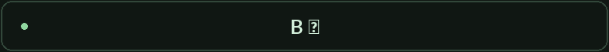
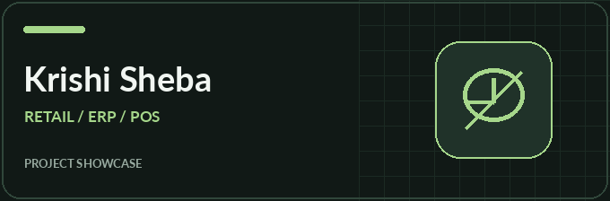
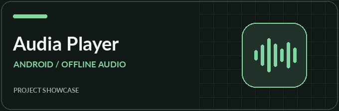
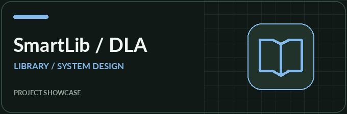
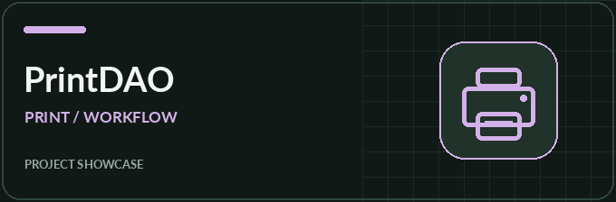
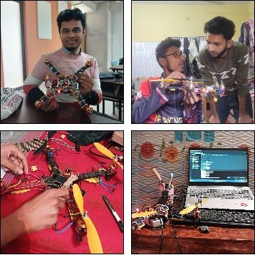

<!-- Personal profile | Tanjil Hasan Himel -->

  
    
  
    
  
  
  
  

👋 About me
I am a Computer Science & Engineering student at Varendra University, Bangladesh, with project experience in web and mobile applications, database-backed systems, and AI-assisted development.

I enjoy exploring the intersection of software engineering, business analysis, product thinking, and workflow automation — understanding a problem, designing a practical solution, and testing how it works.
<table>
<tr>
<td width="50%" valign="top">
<h3>🛠️ What I build</h3>
Web & mobile applications Database-backed systems SaaS and operational workflows API integrations & automation
</td>
<td width="50%" valign="top">
<h3>🔎 What I am developing</h3>
Business & product analysis Data analytics and applied AI Software quality assurance Independent engineering skills
</td>
</tr>
</table>
Open to: Entry-level opportunities, internships, paid freelance work, and remote collaboration.
🚀 Featured projects
<table>
<tr>
<td width="50%" valign="top">

<h3>Krishi Sheba</h3>

Agricultural retail SaaS for inventory, POS, credit and accounting workflows.

Prototype / live preview

  

 

</td>
<td width="50%" valign="top">

<h3>Audia Player</h3>

Offline native Android music player with playback tools, scheduling and adaptive interfaces.

Public APK / repository

   

  

</td>
</tr>
<tr>
<td width="50%" valign="top">

<h3>SmartLib / DLA</h3>

Team academic project connecting student, librarian and institutional library workflows.

Academic prototype

  

 

</td>
<td width="50%" valign="top">

<h3>PrintDAO</h3>

Campus print workflow connecting uploads, payment verification, print queues and local printers.

Project / case study

  

</td>
</tr>
<tr>
<td width="50%" valign="top">

<h3>Quark Ledger</h3>

News collection and automated content workflow project.

Web project

 

</td>
<td width="50%" valign="top">

<h3>T Double H FM</h3>

Internet radio and streaming project exploring digital audio workflows.

Web project

</td>
</tr>
</table>Project artwork is illustrative, not a screenshot of the applications. Follow the project links for actual interfaces and documentation.
📋 Business & product case studies
Case study	Areas explored	Documentation
Krishi Sheba	Retail requirements, operational workflows, feature prioritization	Read
SmartLib	Library workflows, user roles, data model and integration	Read
PrintDAO	Print queues, payment approval and desktop integration	Read
Audia Player	Offline-first mobile product experience and adaptive UI	Read

🛩️ Hardware & embedded systems
<table>
<tr>
<td width="47%" valign="top"></td>
<td width="53%" valign="top">
<h3>ESP32 Custom Flight Controller Drone</h3>
An academic team project exploring a custom flight controller built around ESP32 rather than a ready-made board.  
<b>Technical work:</b> Sensor fusion, MPU6050 filtering, motor mixing, PID tuning, ESC calibration and Wi-Fi control.  
    
</td>
</tr>
</table>🧰 Technical toolkit
Technologies I have used or explored through projects. These do not imply equal proficiency in every tool.
<table>
<tr><td width="50%" valign="top" align="center"><h3>Languages</h3></td><td width="50%" valign="top" align="center"><h3>Web & mobile</h3></td></tr>
<tr><td valign="top" align="center"><h3>Backend & databases</h3></td><td valign="top" align="center"><h3>Cloud & deployment</h3></td></tr>
<tr><td valign="top" align="center"><h3>Development & design</h3></td><td valign="top" align="center"><h3>Hardware & mobile tools</h3> ESP32 · MPU6050 · Jetpack Compose · Media3</td></tr>
</table>⚡ AI & automation

I use AI-assisted tools for prototyping, development and workflow exploration while building the skills to inspect implementation, test behaviour, and understand technical trade-offs independently.
🎙️ Beyond engineering
<table>
<tr><td align="center" width="25%"> <b>Radio Presenter</b></td><td valign="top">Experience in live broadcasting, audience engagement, storytelling, and team collaboration. These skills complement my technical work and interest in client-facing and product-oriented roles.</td></tr>
</table>🤝 Connect with me

  <b>Technology · Business · Product</b>  
  
  
  
  
    
  Think clearly. Build thoughtfully. Keep learning.

