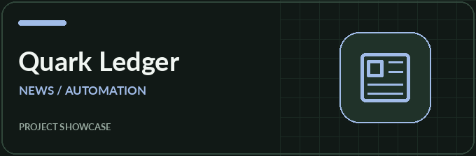

  
    
   &nbsp;  &nbsp;  &nbsp;  &nbsp; 

About me
I am a Computer Science & Engineering student at Varendra University, Bangladesh. I build web and mobile applications, explore how business operations can be improved through software, and work with data and automation. My radio broadcasting experience complements my technical work through communication and storytelling.

Open to: Entry-level roles, internships, paid freelance work and remote collaboration.
Selected projects
A selection of my applications, prototypes and academic work. Each project includes its purpose, relevant implementation stack and available links.
<table>
  <tr>
    <td width="50%" valign="top">
      
      <h3>Audia Player</h3>
      
<b>Native Android · Public app release</b>

      
An offline music player with adaptive layouts, scheduled playback and media controls.

      

      
<b>How it is built</b> Kotlin builds the app; Jetpack Compose powers its UI; Media3 / ExoPlayer handles playback; Room Database stores local data.

      
<a href="https://tanjilhasanhimel.me/audia/"><b>View app website →</b></a> <a href="https://github.com/TanjilHasan-Himel/app"><b>View source code →</b></a> <a href="https://github.com/TanjilHasan-Himel/app/releases/latest/download/Audia-latest.apk"><b>Download Android APK →</b></a>

    </td>
    <td width="50%" valign="top">
      
      <h3>Krishi Sheba</h3>
      
<b>Retail SaaS · Prototype</b>

      
An agricultural shop management system for sales, inventory, credit and accounting.

      

      
<b>How it is built</b> Next.js powers the web interface; PostgreSQL stores operational records.

      
Fastify is listed in the project architecture.

      
<a href="https://khrisisheba-saas-pos.vercel.app/"><b>Open live demo →</b></a> <a href="https://tanjilhasanhimel.me/krishisheba/"><b>Read case study →</b></a>

    </td>
  </tr>
  <tr>
    <td width="50%" valign="top">
      
      <h3>SmartLib / DLA</h3>
      
<b>Academic team project</b>

      
A library system for student verification, borrowing, returns and librarian operations.

      

      
<b>How it is built</b> Flutter powers the mobile app; Django REST Framework serves APIs; MongoDB Atlas stores records.

      
Stripe and SSLCOMMERZ: sandbox payment integrations.

      
<a href="https://tanjilhasanhimel.me/smartlib/"><b>Read case study →</b></a> <a href="https://www.youtube.com/watch?v=SxjPciMqh5Y&amp;t=816s"><b>Watch project demo →</b></a>

    </td>
    <td width="50%" valign="top">
      
      <h3>PrintDAO</h3>
      
<b>Workflow automation · Project</b>

      
A printing workflow that connects uploads, payment approval, queues and local printers.

      

      
<b>How it is built</b> Next.js powers the web portal; Supabase handles data and queue updates; Python / CustomTkinter runs the desktop print bridge.

      
<a href="https://tanjilhasanhimel.me/printdao/"><b>Read case study →</b></a>

    </td>
  </tr>
  <tr>
    <td width="50%" valign="top">
      
      <h3>Quark Ledger</h3>
      
<b>News automation · Web project</b>

      
A news collection and content routing workflow.

      

      
<b>How it is built</b> n8n and Webhooks connect the automation steps.

      
<a href="https://quarkledger.vercel.app/"><b>Open website →</b></a>

    </td>
    <td width="50%" valign="top">
      
      <h3>T Double H FM</h3>
      
<b>Internet radio · Web project</b>

      
A digital radio project exploring online listening and audio workflows.

      
<b>How it is built</b> Digital audio and web delivery.

      
<a href="https://tdoublehfm.vercel.app/"><b>Open radio website →</b></a>

    </td>
  </tr>
</table>Additional projects
<table>
  <tr>
    <td width="50%" valign="top">
      <h3>AI Writing Assistant</h3>
      
Academic web prototype connecting a local language model to a writing interface with authentication and saved messages.

      

      
<b>Implementation:</b> PHP, MySQL, Ollama and cURL.

    </td>
    <td width="50%" valign="top">
      <h3>Nirbhor</h3>
      
Domestic helper platform with user roles, authentication and service workflows.

      

      
<b>Implementation:</b> React, Express.js, MySQL2 and JWT.

    </td>
  </tr>
</table>Embedded systems — ESP32 custom flight controller drone
<table>
  <tr>
    <td width="43%" valign="top"></td>
    <td width="57%" valign="top">
      
An academic team project exploring flight control using an ESP32 instead of a ready-made controller.

      

      
<b>Sensor fusion:</b> MPU6050 and Madgwick Filter.

      
<b>Control:</b> PID Control, Motor Mixing, PWM and ESC calibration.

      
<b>Communication:</b> UDP / Wi-Fi.

    </td>
  </tr>
</table>Development toolkit
Technologies grouped by what I use them for. Tools listed here include project work, coursework and exploration; they do not imply equal proficiency.
<table>
  <tr>
    <td width="50%" valign="top">
      <h3>Web applications</h3>
      
Interfaces, dashboards and business workflows.

      
 

      
<b>TypeScript · JavaScript · React · Next.js · Tailwind CSS</b>

      
HTML · CSS · shadcn/ui · Vite

    </td>
    <td width="50%" valign="top">
      <h3>WordPress &amp; CMS</h3>
      
Content-managed websites and local CMS development.

      
 

      
<b>WordPress · PHP · MySQL</b>

      
Local WP · XAMPP

    </td>
  </tr>
  <tr>
    <td width="50%" valign="top">
      <h3>Android &amp; cross-platform</h3>
      
Native Android apps and cross-platform interfaces.

      
 

      
<b>Kotlin · Dart · Flutter · Android Studio</b>

      
Jetpack Compose · Media3 · ExoPlayer · Room Database

    </td>
    <td width="50%" valign="top">
      <h3>Backend &amp; APIs</h3>
      
Application logic, authentication and integrations.

      
 

      
<b>Python · Node.js · Express.js · Django</b>

      
Django REST Framework · REST APIs · Fastify (architecture) · MySQL2

    </td>
  </tr>
  <tr>
    <td width="50%" valign="top">
      <h3>Databases &amp; storage</h3>
      
Application records, relational data and live updates.

      
 

      
<b>PostgreSQL · Supabase · MongoDB · Redis</b>

      
MySQL · SQLite · Firebase · Prisma

    </td>
    <td width="50%" valign="top">
      <h3>Programming &amp; problem solving</h3>
      
Coursework, embedded programming and data queries.

      
 

      
<b>Java · C · C++</b>

      
SQL · Python

    </td>
  </tr>
  <tr>
    <td width="50%" valign="top">
      <h3>Cloud &amp; deployment</h3>
      
Hosting web apps and backend services.

      
  

      
<b>Vercel · Netlify · Docker · Linux</b>

      
Render · Railway · cPanel · Namecheap

    </td>
    <td width="50%" valign="top">
      <h3>Development &amp; delivery</h3>
      
Version control, CI workflows and builds.

      
 

      
<b>Git · GitHub · GitHub Actions · VS Code · Gradle</b>

      
npm · pnpm

    </td>
  </tr>
  <tr>
    <td width="50%" valign="top">
      <h3>Testing &amp; technical design</h3>
      
API testing, test writing and technical diagrams.

      
 

      
<b>Postman · Jest · Figma</b>

      
REST Client · Mermaid · draw.io

    </td>
    <td width="50%" valign="top">
      <h3>Integration &amp; desktop tools</h3>
      
Desktop utilities, authentication and payment integrations.

      
 

      
<b>Tkinter · CustomTkinter · JWT · bcrypt</b>

      
CORS · cURL · Supabase Realtime · Row-Level Security (RLS) · Stripe / SSLCOMMERZ (sandbox)

    </td>
  </tr>
</table>Data, analytics & automation
The tools I use for data exploration, coursework, model experimentation and connecting services. Specific project integrations are described in the project cards above.
<table>
  <tr>
    <td width="50%" valign="top">
      <h3>Data analysis</h3>
      
Clean, explore and visualize data.

      
  

      
<b>Python · SQL · NumPy · Pandas · Matplotlib</b>

      
Microsoft Excel for spreadsheet analysis.

    </td>
    <td width="50%" valign="top">
      <h3>Machine learning</h3>
      
Practice model building and experimentation.

      
 

      
<b>Scikit-learn · PyTorch · TensorFlow</b>

      
Jupyter Notebook · Google Colab

    </td>
  </tr>
  <tr>
    <td width="50%" valign="top">
      <h3>Workflow automation</h3>
      
Connect services and automate repetitive steps.

      
 

      
<b>n8n · Webhooks · REST APIs · MCP</b>

      
Used for integration and workflow experiments.

    </td>
    <td width="50%" valign="top">
      <h3>Model integration</h3>
      
Work with hosted and local model interfaces.

      
 

      
<b>OpenAI API · Gemini API · Anthropic API · Ollama</b>

      
Local LLM APIs · Google AI Studio

    </td>
  </tr>
</table>

<b>Development assistants</b> — optional tools in my workflow

OpenAI Codex · Claude Code · Cursor · GitHub Copilot · Google Antigravity · Bolt.new

Product & business perspective
I am interested in the requirements, user needs and operational decisions behind digital products. These projects provide examples of that perspective, rather than claims of formal analyst or product manager experience.
<table>
  <tr>
    <td width="50%" valign="top">
      <h3>Requirements &amp; workflows</h3>
      
Retail operations, user roles, approvals and queues.

      
   

      
<b>Krishi Sheba · SmartLib · PrintDAO</b>

      
Notion · Jira · Trello for planning and documentation.

    </td>
    <td width="50%" valign="top">
      <h3>Product experience &amp; design</h3>
      
Interface planning, offline-first experiences and process diagrams.

      
 

      
<b>Audia Player · Figma</b>

      
Microsoft Excel · Mermaid · draw.io for analysis and documentation.

    </td>
  </tr>
</table>Beyond engineering
<table>
  <tr>
    <td width="50%" valign="top">
      <h3>Radio broadcasting</h3>
      
<b>Radio Padma 99.2 FM · Presenter / RJ</b>

      
Live presenting, audience engagement, storytelling and collaboration in a broadcast environment.

      
<b>Selected shows:</b> Hello Rajshahi, Ferari Bikel, Duronto Rajshahi, Worldmusic, Your Request Your Playlist and Bioscope.

    </td>
    <td width="50%" valign="top">
      <h3>Audio & creative production</h3>
      
Audio recording, editing, restoration and visual storytelling.

      
  

      
 

      
DaVinci Resolve · CapCut · Blackmagic Camera

    </td>
  </tr>
</table>

  <b>Explore more of my work</b>  
  <a href="https://tanjilhasanhimel.me/">Portfolio and case studies →</a>

