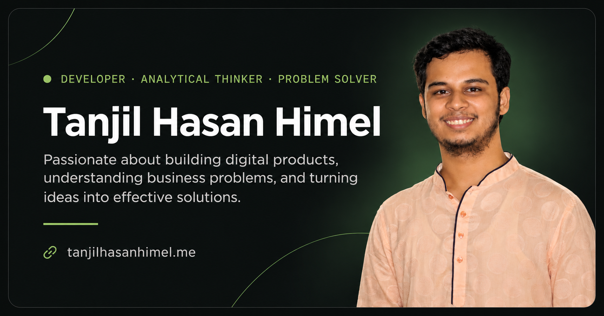

 &nbsp;  &nbsp;  &nbsp;  &nbsp; 

<h2 align="center">About me</h2>
I am a Computer Science &amp; Engineering student at Varendra University, Bangladesh. I build web and mobile applications, work with business workflows and explore practical uses of data and automation.

I also work in radio broadcasting, where I develop my communication and storytelling skills.

<b>Open to:</b> Entry-level roles · Internships · Paid freelance work · Remote collaboration

<h2 align="center">Selected projects</h2>
A selection of applications, prototypes and academic engineering work.

<table align="center">
<tr>
<td width="50%" valign="top" align="left">
<h3>SmartLib / DLA</h3>

Final year project · Team Lead &amp; Core Developer

Multi-tenant academic library platform with a student app, librarian dashboard and super-admin dashboard.

<b>Built with:</b> Flutter · Django REST Framework · MongoDB Atlas

<a href="https://tanjilhasanhimel.me/smartlib/">Read case study</a> &nbsp;·&nbsp; <a href="https://www.youtube.com/watch?v=SxjPciMqh5Y&amp;t=816s">Watch project video</a>

</td>
<td width="50%" valign="top" align="left">
<h3>Audia Player</h3>

Native Android · Public release

Offline music player with adaptive layouts, media controls and scheduled playback.

<b>Built with:</b> Kotlin · Jetpack Compose · Media3 · Room

<a href="https://tanjilhasanhimel.me/audia/">App website</a> &nbsp;·&nbsp; <a href="https://github.com/TanjilHasan-Himel/app">Source code</a> &nbsp;·&nbsp; <a href="https://github.com/TanjilHasan-Himel/app/releases/latest/download/Audia-latest.apk">Download APK</a>

</td>
</tr>
<tr>
<td width="50%" valign="top" align="left">
<h3>Krishi Sheba</h3>

Retail SaaS · Prototype

Agricultural retail workflows for inventory, sales, credit and accounting.

<b>Built with:</b> Next.js · PostgreSQL

<a href="https://khrisisheba-saas-pos.vercel.app/">Open live demo</a> &nbsp;·&nbsp; <a href="https://tanjilhasanhimel.me/krishisheba/">Read case study</a>

</td>
<td width="50%" valign="top" align="left">
<h3>PrintDAO</h3>

Print automation · Prototype

Document uploads, payment verification, print queues and desktop printer integration.

<b>Built with:</b> Next.js · Supabase · Python · CustomTkinter

<a href="https://printdao.vercel.app/">Open live demo</a> &nbsp;·&nbsp; <a href="https://tanjilhasanhimel.me/printdao/">Read case study</a>

</td>
</tr>
</table>
<h3 align="center">SmartLib — Final year capstone</h3>
<b>Varendra University · Department of CSE · July 2026</b> Team Lead &amp; Core Developer · Three-member project Supervisor: Md. Arshad Wasif, Lecturer, Dept. of CSE

I led the system architecture, mobile development, core implementation, testing and documentation.

<b>Explore architecture &amp; implementation</b>
Area	Implementation
Architecture	Multi-tenant isolation, university-specific administration, Django database routing, Djongo, legacy SQL / API integration, separate institutional integration server, CSV onboarding and audit logging
Security	JWT access/refresh tokens, RBAC, configurable login sessions, email OTP, HMAC-SHA256 digital ID QR codes rotating every 30 seconds
Library workflows	Catalog, borrowing and returns, stock tracking, expected return dates, tenant-specific policies, digital receipts and PDF reporting
AI & notifications	Gemini API with database context and usage quotas, custom SMTP templates, email and in-app alerts
Payments	Fine calculation, Stripe and SSLCOMMERZ sandbox checkout and webhook updates
Technology	Flutter, Dart, Python, Django REST Framework, MongoDB Atlas free tier, HTML, CSS, JavaScript; deployed on Render and temporarily used DigitalOcean

Academic prototype, primarily tested on Android. Team: Tanjil Hasan, Khadiza-tul Kubra Orin and Md. Rashidul Islam.

<h3 align="center">Additional projects</h3><table align="center">
<tr><td width="50%" align="left" valign="top"><b><a href="https://quarkledger.vercel.app/">Quark Ledger</a></b>
News collection and routing using n8n and webhooks.
</td><td width="50%" align="left" valign="top"><b><a href="https://tdoublehfm.vercel.app/">T Double H FM</a></b>
Internet radio and digital audio delivery.
</td></tr>
<tr><td width="50%" align="left" valign="top"><b>AI Writing Assistant</b>
Academic prototype with PHP, MySQL, cURL and Ollama.
</td><td width="50%" align="left" valign="top"><b>Nirbhor</b>
Domestic helper platform with React, Express.js, MySQL2, JWT, bcrypt and CORS.
</td></tr>
</table>
<h3 align="center">ESP32 Custom Flight Controller</h3>

Academic team project exploring custom flight control with ESP32 and C++. Arduino · MPU6050 · Madgwick Filter · PID · PWM · ESC · UDP / Wi-Fi

<h2 align="center">Technology toolkit</h2>
Selected technologies I use or have explored in projects and coursework. Grouped by what I use them for, rather than a claim of proficiency.

<h3 align="center">Languages & queries</h3>
Application logic, mobile development and data queries.

 &nbsp;  &nbsp;  &nbsp;  &nbsp; 

Dart · Java · C · C++ · PHP

<h3 align="center">Web, mobile & backend</h3>
Application interfaces, services and content-managed websites.

 &nbsp;  &nbsp;  &nbsp;  &nbsp;  &nbsp; 

Jetpack Compose · Django REST Framework · Express.js · Tailwind CSS

<h3 align="center">Databases & storage</h3>
Application records, tenant data and local storage.

 &nbsp;  &nbsp;  &nbsp; 

MySQL · SQLite · Redis

<h3 align="center">Cloud & delivery</h3>
Hosting and deploying applications.

 &nbsp;  &nbsp;  &nbsp; 

Netlify · Git · GitHub Actions

<h3 align="center">Data analysis & automation</h3>
Coursework, data exploration and service integration.

 &nbsp;  &nbsp;  &nbsp; 

Matplotlib · Microsoft Excel · REST APIs · Webhooks

<b>Additional technologies &amp; engineering tools</b>

 

<b>Web &amp; CMS</b> HTML · CSS · shadcn/ui · Vite · Local WP · XAMPP

<b>Mobile &amp; desktop</b> Android Studio · Media3 · ExoPlayer · Room Database · Tkinter · CustomTkinter

<b>Backend &amp; data</b> Fastify (architecture) · MySQL2 · Prisma · MongoDB Atlas · Djongo · Firebase

<b>Security &amp; integration</b> JWT · RBAC · HMAC-SHA256 · OTP · SMTP · bcrypt · CORS · cURL · RLS · Stripe · SSLCOMMERZ

<b>Infrastructure &amp; delivery</b> Docker · Linux · cPanel · Namecheap

<b>Development &amp; testing</b> GitHub · VS Code · Gradle · npm · pnpm · Postman · REST Client · Jest

<b>Machine learning &amp; model integration</b>

 

<b>Experimentation</b> PyTorch · TensorFlow · Jupyter Notebook · Google Colab

<b>Model integration</b> OpenAI API · Gemini API · Anthropic API · Ollama · MCP · Google AI Studio

<b>Development assistants</b>

 

OpenAI Codex · Claude Code · Cursor · GitHub Copilot Google Antigravity · Bolt.new

Supporting tools for prototyping, implementation and code review.

<h2 align="center">Product &amp; business perspective</h2>
I am interested in understanding user needs, requirements and operational workflows before deciding how a product should work.

<b>SmartLib</b> — institutional onboarding and access policies <b>Krishi Sheba</b> — retail operations and inventory <b>PrintDAO</b> — customer-to-printer workflow <b>Audia Player</b> — offline experience and adaptive interfaces

<b>Planning &amp; documentation</b> Notion · Jira · Trello · Figma · Mermaid · draw.io · Microsoft Excel

<h2 align="center">Beyond engineering</h2><h3 align="center">Radio broadcasting</h3>
<b>Radio Padma 99.2 FM · Presenter / RJ</b> Live presenting, audience engagement, storytelling and collaboration.

Hello Rajshahi · Ferari Bikel · Duronto Rajshahi World Music · Your Request Your Playlist · Bioscope
<h3 align="center">Creative production</h3>
Audio editing, restoration, video editing and visual storytelling.

<b>Creative tools</b>

 

Studio One 6 · iZotope RX · Audacity Adobe Photoshop · Adobe Premiere Pro · DaVinci Resolve CapCut · Blackmagic Camera

<a href="https://tanjilhasanhimel.me/">Visit my portfolio for more projects and case studies</a>

